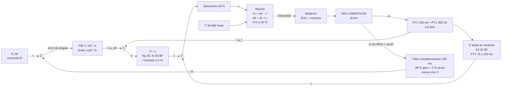

# Contexto: balancín de 2 motores (rama `SCD`)

Resumen de una conversación con el agente de Cursor (2 de noviembre de 2026). Sirve para retomar el trabajo en otra máquina: en un chat nuevo, pedile al agente que lea este archivo.

## Estado del repo

- **Rama:** `SCD`, último commit `5406c11b` ("Funciona maso").
- **Remoto:** `git@github.com:Lucas-el-pato/FC-DRON-P3.git`.
- **Firmware que corre:** en `PinCubeMX/Core/Src/main.c`, `APP_BALANCER` vale 1 por defecto, así que `main` llama a `bal_run()` (balancín) y no a `fc_run()` (dron).
- **Código del balancín:** `PinCubeMX/app/balancer/` (`balancer.c`, `bal_pid.c`, `bal_link.c`, `bal_config.h`).
- **Diferencias con el dron:** el balancín no usa el receptor CRSF, el failsafe de radio, el mixer quad-X ni la telemetría. La referencia y el throttle llegan desde la PC por USB CDC.

## Cómo funciona

### Comandos desde la PC

Por USB CDC, una línea de texto por comando. `bal_link` los lee cada 5 ms.

| Comando | Efecto |
|---|---|
| `A` | Armar |
| `D` | Desarmar (parar) |
| `R <deg>` | Ángulo de referencia, limitado a ±30° |
| `T <pct>` | Throttle base, de 0 a 20 % (10 % por defecto) |
| `Z` | Guarda el ángulo actual como cero (trim de montaje, solo en RAM). Requiere estar desarmado y con la calibración terminada |
| `?` | Estado |

### Lazo de control

Es un PID en cascada sobre un solo eje (roll de la IMU):

1. **PID 1, lazo de ángulo (solo P):** \( \omega_{ref} = 4\,(\theta_{ref} - \theta) \), limitado a ±120 °/s.
2. **PID 2, lazo de velocidad (P + I + D):** \( e = \omega_{ref} - \omega_f \). La D se calcula sobre la medición \( \omega_f \), no sobre el error. La suma P + I + D se satura a ±8 % de motor.
3. **Mezcla:** \( v_R = thr + \tau \) para M3 (derecha, CH2) y \( v_L = thr - \tau \) para M1 (izquierda, CH4). Cada motor queda entre 4 % y 20 %. M2 y M4 reciben siempre DShot 0. La salida va por DShot300.



### Frecuencias

| Etapa | Frecuencia |
|---|---|
| Lectura del gyro y PT1 de 150 + 300 Hz | 8 kHz (interrupción DRDY de la IMU en PC2) |
| Seguridad, PID, mezcla y DShot | 2 kHz (una de cada 4 muestras del gyro) |
| Actitud (θ), filtro complementario | 100 Hz. Para el PID, θ queda retenido 10 ms (como un ZOH) |
| Lectura de comandos de la PC (LINK) | 200 Hz (cada 5 ms) |
| Chequeo del puerto USB | cada 10 ms |
| Batería | 10 Hz |

### Calibración y ángulo cero

- Al encender, el firmware calibra el bias del gyro durante 1.25 s (10 000 muestras). No hay que mover el balancín mientras tanto.
- El acelerómetro no se nivela al encender: 0° es el horizonte real (la gravedad). Si la IMU no quedó montada perfectamente plana, se corrige con el comando `Z` estando nivelado.
- Signo: θ es positivo en sentido antihorario visto desde atrás del FC, o sea con el lado izquierdo (M1) abajo.

### Armado y desarme

- **Para armar (`A`) se necesita:** IMU detectada, motores inicializados, calibración terminada, puerto USB abierto (DTR alto) e inclinación de hasta 70°.
- **Al armar:** se mandan por DShot los comandos de sentido de giro a M1 y M3, se resetea el PID y el LED pasa a verde.
- **Se desarma con:** el comando `D`, el puerto USB cerrado, una inclinación mayor a 80° o 50 lecturas del gyro fallidas seguidas.
- **Riesgo pendiente:** no hay un watchdog que controle la llegada de comandos. Si el programa de la PC se cuelga pero deja el puerto abierto, el balancín sigue armado con la última referencia y el último throttle.

## Parámetros: firmware y SI

Las ganancias del firmware están en "unidades Betaflight": `PID_PTERM_SCALE = 0.032029`, `PID_ITERM_SCALE = 0.244381`, `PID_DTERM_SCALE = 0.000529`, y la suma se divide por 1000. El balancín no usa `PID_GAIN_SCALE` ni `PID_D_SCALE`, que sí usa el dron.

| Parámetro | Firmware (`bal_config.h`) | SI (fracción de motor, rad) |
|---|---|---|
| `K_th` | `BAL_LEVEL_GAIN` = 4 °/s por grado | 4 1/s (constante de tiempo de 0.25 s) |
| `w_ref_max` | `BAL_LEVEL_MAX_RATE_DPS` = 120 °/s | 2.094 rad/s |
| Referencia máxima | `BAL_REF_LIMIT_DEG` = 30° | 0.524 rad |
| `Kp_w` | `BAL_KP` = 40 | 0.032029·40/1000·180/π = 0.0734 |
| `Ki_w` | `BAL_KI` = 60 | 0.244381·60/1000·180/π = 0.840 |
| `Kd_w` | `BAL_KD` = 20 | 0.000529·20/1000·180/π = 6.06e-4 |
| Límite de I | `BAL_ITERM_LIMIT` = 50 | ±0.05 |
| Límite de τ | `BAL_CORR_LIMIT` = 0.08 | ±0.08 |
| Rango de cada motor | `BAL_IDLE` = 0.04, `BAL_MOTOR_LIMIT` = 0.20 | 0.04 a 0.20 |
| Throttle base | `BAL_BASE_THROTTLE` = 0.10 | 0.10 |
| Complementario | `SENSORS_COMP_ALPHA` = 0.02, accel confiable entre 0.85 y 1.15 g | igual |
| Salida al ESC | DShot = 48 + v·1999 | |

Todos los parámetros están dentro de `#ifndef`, así que se pueden cambiar compilando con `-D...=valor`.

## Filtros PT1

PT1 es un filtro pasabajos de primer orden (`PinCubeMX/app/control/filter.c`):

\[
G(s) = \frac{1}{T_f s + 1}, \qquad T_f = \frac{1}{2\pi f_c}, \qquad y_k = y_{k-1} + k\,(x_k - y_{k-1}), \qquad k = \frac{T_s}{T_f + T_s}
\]

| Dónde | Cortes | \( T_s \) | \( T_f \) | \( k \) |
|---|---|---|---|---|
| Gyro (para P, I y D) | 150 Hz | 0.125 ms | 1.061 ms | 0.1054 |
| Gyro (para P, I y D) | 300 Hz | 0.125 ms | 0.531 ms | 0.1907 |
| Solo la D | 75 Hz | 0.5 ms | 2.122 ms | 0.1907 |
| Solo la D | 150 Hz | 0.5 ms | 1.061 ms | 0.3203 |

En Simulink, cada PT1 discreto es un Discrete Transfer Fcn \( H(z) = \frac{k\,z}{z - (1-k)} \), con numerador `[k 0]` y denominador `[1 -(1-k)]`.

## Por qué la D va sobre la medición

\[
D_{error} = K_d \frac{d\omega_{ref}}{dt} - K_d \frac{d\omega_f}{dt}, \qquad D_{medición} = -K_d \frac{d\omega_f}{dt}
\]

Con la referencia quieta, las dos formas dan lo mismo. Pero en el balancín \( \omega_{ref} \) cambia en escalones en dos casos:

- **Comando `R`:** pasar de 0° a 10° hace saltar \( \omega_{ref} \) 0.698 rad/s de un paso al otro. Con D sobre el error, la D daría unas diez veces el límite de ±0.08 y le pegaría un golpe a los motores.
- **Actualización de θ:** cada 10 ms θ cambia en escalón, así que con D sobre el error habría un pequeño pico cada vez (un zumbido a 100 Hz).

## Latencia estimada (sin medir)

- **Procesamiento:** desde la interrupción de la IMU hasta que el ESC termina de recibir el frame DShot pasan unos 0.1 ms. Eso incluye leer el SPI1 a 5.25 Mbit/s (~15–20 µs), los cálculos (~10–20 µs) y el frame DShot300 (53 µs).
- **Espera hasta el próximo PID:** de 0 a 500 µs.
- **Filtros:** ≈1.6 ms para P e I, y ≈4.8 ms para la D (que pasa por los cuatro PT1).
- **θ:** tiene entre 0 y 10 ms de antigüedad.
- **Comandos de la PC:** hasta unos 5 ms (por la tarea LINK), más ~1 ms del sondeo USB.
- **Pendiente:** el scheduler guarda la peor duración del ciclo del PID en `scheduler_pid_max_us()`, pero hoy no se imprime en ningún lado.

## Modelo en MATLAB (equivalente al firmware)

Las funciones originales que se le pasaron a otro chat no se encontraron, así que este código se escribió desde cero a partir del firmware. Para que el lazo tenga realimentación negativa, en la planta más empuje en M3 (derecha) que en M1 tiene que hacer crecer θ: \( \ddot\theta \propto (F_R - F_L) \).

```matlab
function par = bal_params()
par.Ts_g   = 1/8000;  par.Ts = 1/2000;  par.Ts_att = 1/100;
par.K_th      = 4;
par.w_ref_max = deg2rad(120);
par.ref_max   = deg2rad(30);
par.Kp_w = 0.032029*40/1000*180/pi;   % 0.0734
par.Ki_w = 0.244381*60/1000*180/pi;   % 0.840
par.Kd_w = 0.000529*20/1000*180/pi;   % 6.06e-4
par.I_max = 0.05;  par.tau_max = 0.08;
par.idle  = 0.04;  par.v_max   = 0.20;
par.Tf_g1 = 1/(2*pi*150);  par.Tf_g2 = 1/(2*pi*300);
par.Tf_d1 = 1/(2*pi*75);   par.Tf_d2 = 1/(2*pi*150);
par.alpha = 0.02;  par.acc_min = 0.85;  par.acc_max = 1.15;
par.trim  = 0;
end

function st = bal_init()
st.g1 = 0; st.w_f = 0; st.w_sum = 0; st.w_n = 0;
st.theta_raw = 0; st.theta = 0; st.att_init = false;
st = bal_reset(st);
end

function st = bal_reset(st)          % al armar y al desarmar
st.I = 0; st.d1 = 0; st.d2 = 0; st.w_prev = 0;
end

function st = bal_gyro_step(st, par, w)   % 8 kHz, w [rad/s] sin bias
k1 = par.Ts_g/(par.Tf_g1 + par.Ts_g);
k2 = par.Ts_g/(par.Tf_g2 + par.Ts_g);
st.g1  = st.g1  + k1*(w - st.g1);
st.w_f = st.w_f + k2*(st.g1 - st.w_f);
st.w_sum = st.w_sum + w;  st.w_n = st.w_n + 1;   % sin filtrar, para la actitud
end

function st = bal_att_step(st, par, ax, ay, az)   % 100 Hz, accel en g
if st.w_n > 0, w_avg = st.w_sum/st.w_n; dt = st.w_n*par.Ts_g;
else,          w_avg = 0;               dt = par.Ts_att; end
st.w_sum = 0; st.w_n = 0;
dt = min(max(dt, 1e-4), 0.1);
th_acc = atan2(ay, az);
a_mag  = sqrt(ax^2 + ay^2 + az^2);
if ~st.att_init
    st.theta_raw = th_acc; st.att_init = true;
elseif a_mag < par.acc_min || a_mag > par.acc_max
    st.theta_raw = st.theta_raw + w_avg*dt;
else
    st.theta_raw = (1 - par.alpha)*(st.theta_raw + w_avg*dt) + par.alpha*th_acc;
end
st.theta_raw = wrapToPi(st.theta_raw);
st.theta     = wrapToPi(st.theta_raw - par.trim);
end

function [vL, vR, st, tau] = bal_ctrl_step(st, par, ref, T)   % 2 kHz
sat = @(x, lo, hi) min(max(x, lo), hi);
ref   = sat(ref, -par.ref_max, par.ref_max);
w_ref = sat(par.K_th*(ref - st.theta), -par.w_ref_max, par.w_ref_max);
e = w_ref - st.w_f;
P = par.Kp_w*e;
st.I = sat(st.I + par.Ki_w*par.Ts*e, -par.I_max, par.I_max);
kd1 = par.Ts/(par.Tf_d1 + par.Ts);  kd2 = par.Ts/(par.Tf_d2 + par.Ts);
st.d1 = st.d1 + kd1*(st.w_f - st.d1);
st.d2 = st.d2 + kd2*(st.d1 - st.d2);
D = -par.Kd_w*(st.d2 - st.w_prev)/par.Ts;
st.w_prev = st.d2;
tau = sat(P + st.I + D, -par.tau_max, par.tau_max);
a   = abs(tau);
thr = sat(T, par.idle, par.v_max);
if thr + a > par.v_max, thr = par.v_max - a; end
if thr - a < par.idle,  thr = par.idle + a;  end
vL = sat(thr - tau, par.idle, par.v_max);   % M1 izquierda
vR = sat(thr + tau, par.idle, par.v_max);   % M3 derecha
end
```

El lazo de simulación sigue el mismo orden que el firmware. A 8 kHz se llama a `bal_gyro_step`. Cada 80 pasos se llama a `bal_att_step` y cada 4 pasos a `bal_ctrl_step`. La planta se integra con `vL` y `vR` constantes entre actualizaciones.

### En Simulink

- **Discreto, no continuo:** el PID tiene que ser discreto, con sample time `0.5e-3`.
- **No usar el bloque PID Controller:** no reproduce el firmware, por tres motivos:
  - deriva el error (el firmware deriva la medición; el bloque *PID Controller (2DOF)* con `c = 0` lo resuelve);
  - tiene un solo filtro en la D (el firmware usa dos PT1);
  - su anti-windup es por integración condicional (el firmware recorta la I a ±0.05).
- **Armarlo con bloques sueltos:**
  - P: Gain `0.0734`.
  - I: Discrete-Time Integrator, ganancia `0.840`, método Backward Euler, límite ±0.05.
  - D: dos Discrete Transfer Fcn (PT1 de 75 y 150 Hz), luego \( (1 - z^{-1})/T_s \) y una Gain `-6.06e-4`. La entrada de la D es \( \omega_f \), no el error.
  - Salida: Sum seguido de una Saturation de ±0.08.
- **θ:** agregar un Zero-Order Hold de 10 ms.

## Archivos clave

| Qué | Dónde |
|---|---|
| Lazo, armado, mezcla y comandos | `PinCubeMX/app/balancer/balancer.c` |
| PID de un eje | `PinCubeMX/app/balancer/bal_pid.c` |
| Parámetros | `PinCubeMX/app/balancer/bal_config.h` |
| Parser de comandos USB | `PinCubeMX/app/balancer/bal_link.c` |
| Filtro PT1 | `PinCubeMX/app/control/filter.c`, `filter.h` |
| Filtro complementario | `PinCubeMX/app/sensors/sensors_scale.c` (`sensors_attitude_update`) |
| Scheduler (8 kHz / 2 kHz / cola lenta) | `PinCubeMX/app/scheduler/scheduler.c` |
| Elección entre balancín y dron | `PinCubeMX/Core/Src/main.c` (`APP_BALANCER`) |
| Reglas para agentes | `AGENTS.md`, `PinCubeMX/AGENTS.md` |

## Notas para Windows

- **Compilar:** desde `PinCubeMX`, con `cmake --preset Balancin` y `cmake --build --preset Balancin`, o con el preset `Debug`, porque `main.c` ya tiene `APP_BALANCER = 1`. Hacen falta `arm-none-eabi-gcc` en el PATH, CMake y Ninja, y STM32Cube F4 V1.28.3. Si el Cube no está en la ruta por defecto, hay que definir la variable de entorno `STM32_CUBE_FW_F4_PATH`.
- **Puerto USB:** el FC aparece como un puerto COM. El programa de la PC tiene que dejar DTR en alto, porque con DTR bajo el balancín se desarma. En `pyserial`, DTR queda en alto por defecto al abrir el puerto.
- **Cambio local sin commitear en Linux:** `PinCubeMX/.settings/language.settings.xml`. Es configuración del IDE y no hace falta llevarlo.
